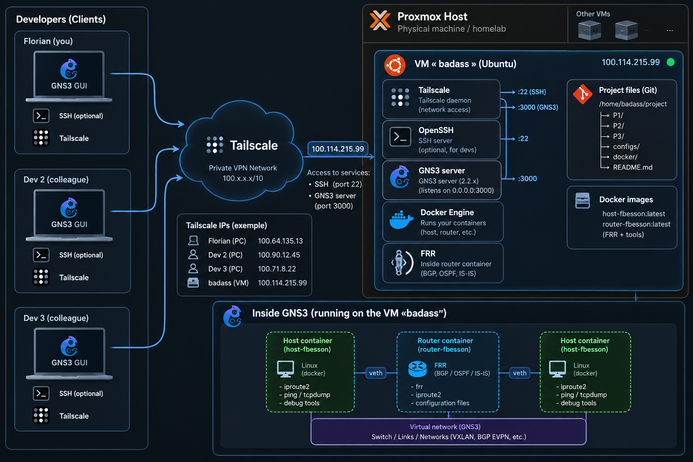

# how to connect to the vm
download tailscale on your host machine and ask me to join the tailnet, after that you can
ssh `user@badass` if MagicDNS is not set you can use the VM ip `user@100.114.215.99`

# how to work on badass

cd `/srv/badass/` and this time add your git ssh key in the VM, don't forget to create your own branch

# how to connect to gns3

since we host gns3 on an ubuntu server we lack graphical interface. we can simply use the host machine graphical interface as a client to connect to the server constantly running on the badass vm. 

download and run `gns3` on your host machine and enter server ip `100.114.215.99` and port `3080`, for the password just `cat` the gns3 server config file in the vm located at `.config/GNS3/2.2/gns3_server.conf`

## architecture

