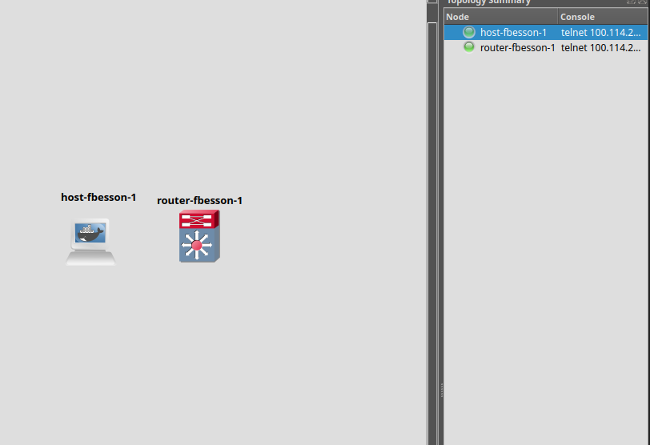

# P1 - GNS3 with Docker

## Images

### host-fbesson
- Alpine-based image
- BusyBox available
- No default IP configuration

### router-fbesson
- Based on FRRouting
- BGPD enabled
- OSPFD enabled
- IS-IS enabled
- BusyBox available
- No default IP configuration

## GNS3

Both images are imported as Docker templates in GNS3.

## Topology:

Both containers can be started and accessed through the GNS3 console.
